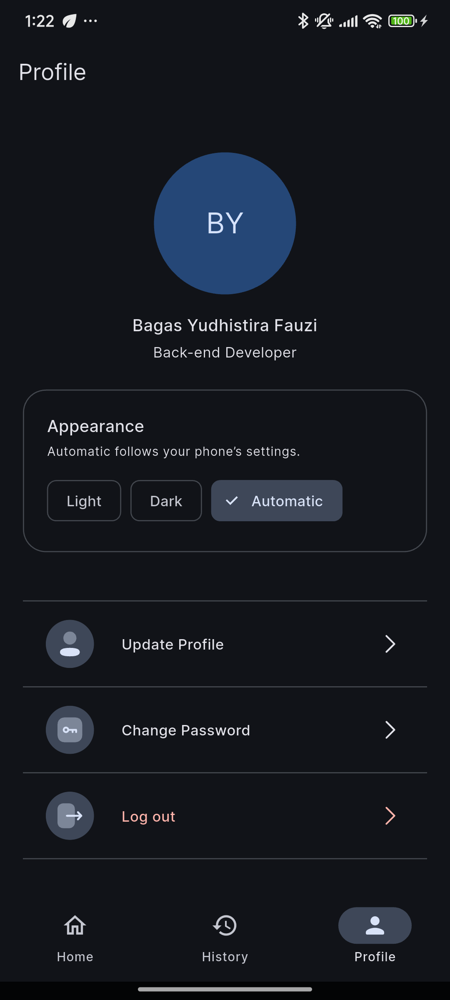

# Atego — Attendance on the Go

A personal Flutter/Firebase attendance project with GPS-based check-in and checkout. Modernized from [Flutter Presence](https://github.com/mrezkys/flutter_presence).

## Features added in this fork

- Android background attendance with a location foreground service.
- Transactional attendance updates and manual check-in/checkout with confirmation.
- Responsive Home, History, and Profile screens with independent loading states.
- Email/password login, verification, and logout confirmation.
- Persistent Light, Dark, and Automatic appearance settings.
- Build-time company, office, and schedule configuration.
- Employee-only Firestore rules and regression tests.
- Updated branding, launcher icons, and phone screenshots.

## App Screenshots

| Login | Home | Profile and appearance |
| --- | --- | --- |
|  |  |  |

## Requirements

| Tool | Requirement |
| --- | --- |
| Flutter / Dart | Flutter 3.50.0 with bundled Dart; see [.flutter-version](.flutter-version) |
| Android | JDK 17, Android SDK, accepted SDK licenses |
| Test device | Android phone with USB debugging or an emulator |
| Windows | Developer Mode enabled; Flutter on PATH |
| Firebase tooling | Node.js supported by Firebase CLI; Dart global executables on PATH |
| Firestore emulator tests | Java 21 |
| iOS builds | macOS and Xcode; runtime integration is unverified |

## Setup

### 1. Clone and install dependencies

```powershell
git clone --branch dev https://github.com/bagasyudhistira/atego-app.git
Set-Location atego-app
flutter doctor -v
flutter pub get
```

### 2. Configure Firebase

In [Firebase Console](https://console.firebase.google.com/):

1. Create a project you own.
2. Enable **Authentication → Email/Password**.
3. Create the default **Cloud Firestore** database.
4. Register Android with package ID `com.bagasyudhistira.atego`.

```powershell
npm install -g firebase-tools
dart pub global activate flutterfire_cli
firebase login
flutterfire configure --project YOUR_FIREBASE_PROJECT_ID --platforms android
```

- Replace `YOUR_FIREBASE_PROJECT_ID` with your project ID.
- If `flutterfire` is not found, add `%LOCALAPPDATA%\Pub\Cache\bin` to PATH and reopen the terminal.
- Use `--platforms android,ios,web` only when configuring all three platforms.
- Verify that all generated files belong to the same project:

| Platform | Local configuration |
| --- | --- |
| Dart | `lib/firebase_options.dart` |
| Android | `android/app/google-services.json` |
| iOS | `ios/Runner/GoogleService-Info.plist` |

Missing native files can be downloaded from **Project settings → Your apps**. See the [FlutterFire setup guide](https://firebase.google.com/docs/flutter/setup).

**Generated configuration is ignored by Git.** Do not force-add it. Inspect FlutterFire changes to [firebase.json](firebase.json) and the Xcode project before committing; retain the emulator/rules settings.

### 3. Configure the company

```powershell
Copy-Item config\company.example.json config\company.local.json
```

Edit the ignored local copy. Replace the example's BY Company branding and office coordinates.

| Setting | Meaning | Default without defines |
| --- | --- | --- |
| `COMPANY_NAME` | In-app branding and tracking notification | Atego |
| `OFFICE_LATITUDE` / `OFFICE_LONGITUDE` | Attendance point | -7.766026 / 110.371772 |
| `OFFICE_RADIUS_METRES` | Inclusive check-in radius | 200 |
| `SHIFT_START_HOUR` / `SHIFT_START_MINUTE` | On-time check-in boundary | 08:00 |
| `SHIFT_END_HOUR` / `SHIFT_END_MINUTE` | On-time checkout boundary | 16:00 |
| `WORKDAYS` | ISO weekdays: Monday=1, Sunday=7 | 1,2,3,4,5 |

- Settings are validated at startup and fixed at build time; hot reload does not update them.
- Use valid coordinates, a positive radius, nonempty weekdays in 1–7, and a same-day shift.
- Company settings do not rename the native package, launcher label, or icon.
- If renaming Android, update application ID/namespace, Kotlin package/source directory, and Firebase registration together. A new package does not migrate old sessions or data.
- **Keep `officeRadiusMetres()` in [firestore.rules](firestore.rules) equal to `OFFICE_RADIUS_METRES`.** Update the emulator boundary test, test, and deploy rules when changing it.

### 4. Test and deploy Firestore rules

```powershell
Push-Location test\firestore
npm ci
npm test
Pop-Location
```

Tests use the isolated `demo-atego-rules` project, not the live database. After they pass:

```powershell
firebase deploy --only firestore:rules --project YOUR_FIREBASE_PROJECT_ID
```

### 5. Create a test employee

1. In **Authentication → Users**, add a user with a real email and unique password.
2. Copy the Authentication UID.
3. Create Firestore document **`employee/{UID}`**, using that exact UID.
4. Add these fields as **strings**:

| Field | Example |
| --- | --- |
| `employee_id` | `EMP-001` |
| `name` | `Test Employee` |
| `email` | Same email as the Authentication user |
| `role` | `employee` |
| `job` | `Developer` |
| `created_at` | `2026-11-18T09:00:00.000` (ISO8601) |

Sign in, request the verification email, open its link, then sign in again.

**Administration:** use Firebase Console with a project-authorized Google account. In-app employee creation is disabled, and current rules deny admin access. Setting `role` to `admin` does not enable supported administration.

**Optional avatars:** provision Firebase Storage with separate owner-only rules. Billing may require Blaze; obtain the project owner's approval first. Supported images: JPEG, PNG, WebP, up to 5 MB.

### 6. Run and build

```powershell
flutter run --dart-define-from-file=config\company.local.json
flutter build apk --debug --dart-define-from-file=config\company.local.json
```

- Debug output: `build/app/outputs/flutter-apk/app-debug.apk`.
- VS Code's **Build Android debug APK** task uses defaults unless configured with the define-file argument.
- Release builds require your own signing configuration.

## Development

```powershell
flutter test
dart format --output=none --set-exit-if-changed lib\app\controllers\attendance_policy.dart test\attendance_policy_test.dart
```

For analysis/tests without Firebase configuration, create a placeholder only if the local file is absent:

```powershell
if (-not (Test-Path lib\firebase_options.dart)) {
    Copy-Item lib\firebase_options.example.dart lib\firebase_options.dart
}
```

The placeholder throws a setup error at runtime. Generate real Firebase configuration before running or building the app.

Launcher artwork: [app-icon.png](assets/images/app-icon.png), [app-icon-foreground.png](assets/images/app-icon-foreground.png). After editing artwork or [flutter_launcher_icons.yaml](flutter_launcher_icons.yaml), run `dart run flutter_launcher_icons`, rebuild, and reinstall.

## Behavior and limitations

| Area | Current behavior / limitation |
| --- | --- |
| Attendance | Check-in on configured workdays within the radius; checkout after leaving or from 23:59. Shift boundaries measure punctuality, not eligibility. |
| Connectivity | Saves require Firestore transactions and network access; manual attendance also requires a fresh location. Cached history can be shown offline. |
| Android tracking | Verified sign-in and location permission required; foreground service uses a separate isolate and persistent notification. Logout requests shutdown but cannot undo an already-submitted write. |
| Lifecycle | No automatic restart after reboot; force-stop, OS termination, or revoked permission can stop tracking. Full device lifecycle validation is pending. |
| Other platforms | iOS background execution is not implemented; other platforms use in-app polling. iOS/Web/Windows runtime integrations are unverified. |
| Time | Device-local time; fixed company timezones and overnight shifts are unsupported. |
| Dashboard | Location labels do not prove service health or a successful attendance save. |
| Appearance | Saved on this device, not synced to Firebase. |

**Device checklist:** verified login, office location, manual confirm/cancel, automatic attendance, history, logout/account switching, denied permissions, minimizing, and GPS/network loss. Use a dedicated test backend, not production attendance data.

**Android build notes:** debug build/install/startup checked with Gradle 9.5.0, AGP 9.3.1, and Kotlin 2.4.20. Older plugin modules use compile SDK 36; built-in Kotlin migration remains pending before a future Flutter upgrade.

## Security

- Verified employees can access only their own document and attendance.
- Profile updates allow only `name`, `avatar`, `position`, and `address`.
- Attendance rules preserve check-in and permit one checkout; employee creation/deletion, role changes, cross-user access, and admin access are denied.
- **Not fraud-proof:** GPS, distance, dates, and punctuality are client-supplied. Rules do not enforce trusted server time, office coordinates, weekdays, or date IDs. Production attendance needs server-side validation.
- Reset accounts using the historically exposed shared password and revoke sessions through trusted administrator tooling.
- Generated Firebase files, `.firebaserc`, and APK/AAB/IPA binaries are ignored. Never commit service-account keys, passwords, or secrets in Dart defines.
- Firebase client keys remain observable in compiled apps. Review API restrictions, usage, and Authentication quotas; validate login/token refresh after changes.
- Old keys remain in Git history and previously published APKs. Removing current files does not erase exposure or resolve alerts. Review/revoke obsolete keys only in projects you control, after checking dependencies.
- Firebase is required; company configuration does not make this app backend-independent.

## Credits

- Original app: [Flutter Presence](https://github.com/mrezkys/flutter_presence) by [mrezkys](https://github.com/mrezkys).
- Original UI design: [mrezkys](https://dribbble.com/mrezkys).
- Original Iconly icons: [Piqo Design](https://www.figma.com/@piqodesign).
- [Upstream tutorials and demo materials](https://github.com/mrezkys/flutter_presence/tree/main/demo) belong to the original project and do not describe this fork's current setup.

## License

The upstream README states MIT, but no standalone upstream license file was found during this update, and this fork has none. Confirm license terms and required notices with the original author before redistribution; attribution alone is not a license.
