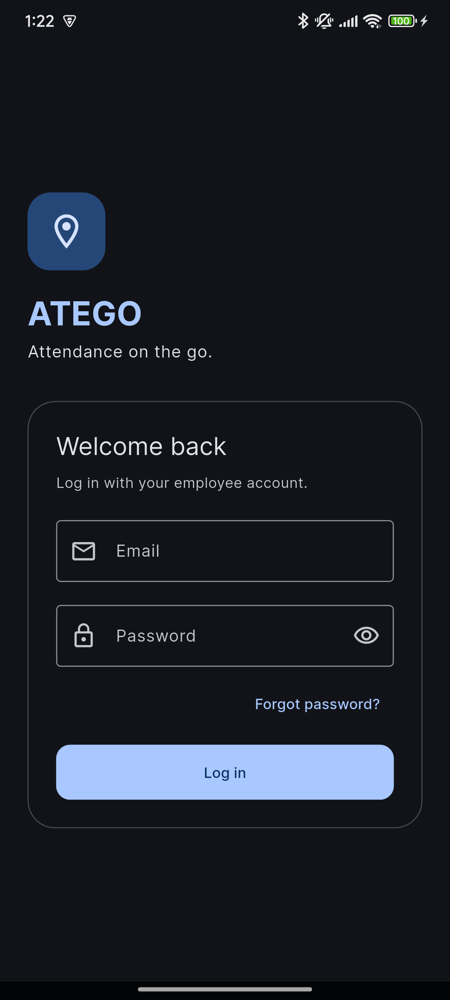
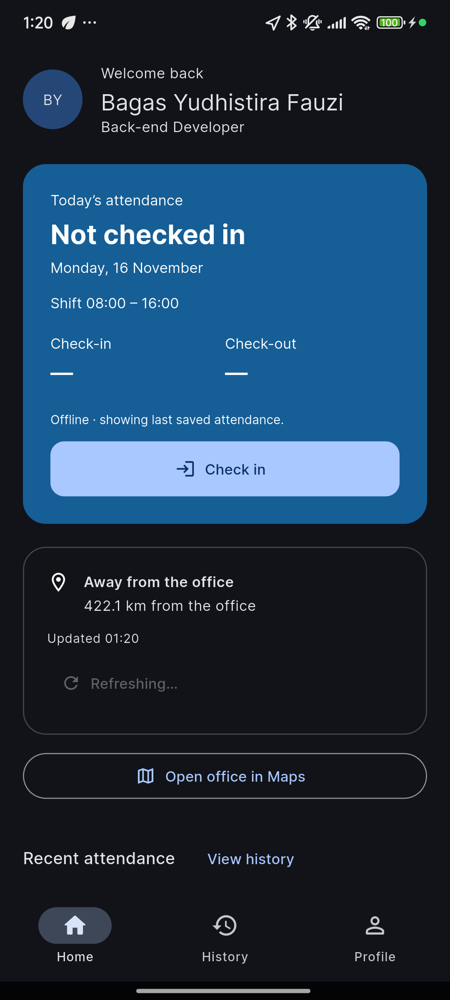

## Introduction

Atego (Attendance on the Go) is an automatic presence application based on Global Positioning System (GPS) for smartphones. Atego can run in the background and record incoming attendance (check-in) when within the radius of the attendance point and record outgoing attendance (check-out) when leaving the radius of the attendance point automatically. Atego is based on mrezkys' flutter_presence repository, which is an open-source project. You can find the repository <a href="https://github.com/mrezkys/flutter_presence/">here.</a>

## App Screenshots

Current interface captured on an Android phone.

Launcher icons and the Web favicon use the login screen's outlined location pin and light-theme colors. Source artwork is in `assets/images/app-icon.png` and `assets/images/app-icon-foreground.png`; regenerate platform assets with `dart run flutter_launcher_icons` after changing the artwork or `flutter_launcher_icons.yaml`. Rebuild and reinstall the app to see the updated launcher icon.

| Login | Home | Profile and appearance |
| --- | --- | --- |
|  |  |  |

## Prerequisites

- Flutter 3.50.0 (the validation version recorded in `.flutter-version`) with its bundled Dart SDK.
- Add Flutter's `bin` directory to PATH, or select your local SDK in VS Code.
- On Windows, enable Developer Mode to allow Flutter plugin symlinks.
- Android testing requires JDK 17, Android SDK command-line tools, accepted SDK licenses, and a phone with USB debugging enabled (or an emulator). Run `flutter doctor -v` to check the setup.
- Android debug APK compilation is verified with Gradle 9.5.0, Android Gradle Plugin 9.3.1, and Kotlin 2.4.20. The output is `build/app/outputs/flutter-apk/app-debug.apk`; installation and startup have been checked on Android, but full background lifecycle behavior still needs device validation. Release builds require a production signing configuration.
- Older Firebase, geolocator, and maps-launcher Android modules are aligned to compile SDK 36 in `android/build.gradle`. Flutter still warns that the app and maps-launcher must migrate to built-in Kotlin before a future Flutter upgrade.
- In VS Code, run the **Build Android debug APK** task. The first build downloads required Android components.
- The checked-in Android package is `com.bagasyudhistira.atego`. Existing Firebase configuration is specific to this fork, not a shared backend for other deployments. Replace it with your own project as described below before testing or distributing your copy.
- Android native configuration and Dart Firebase options must target the same registered Firebase app. Web and iOS still contain legacy Firebase configuration; do not launch them until they are configured for an isolated test backend.
- Changing the Android package creates a separate installed app; it does not migrate sessions or data from `com.bagasyudhistira.presence`.

## Development checks

```powershell
flutter pub get
dart format --output=none --set-exit-if-changed lib/app/controllers/attendance_policy.dart test/attendance_policy_test.dart
flutter test test/attendance_policy_test.dart
```

Attendance uses the device's local date/time. Compatibility defaults are weekday-only check-in, a 200-metre office radius, and 08:00–16:00 shift boundaries; these office and schedule settings can be overridden at build time. Leaving the radius triggers checkout; 23:59 is the existing day-end fallback. Boundary times are inclusive. Existing attendance document IDs and fields are retained.

Tracking is started only for authenticated, email-verified users. On Android, a location foreground service runs attendance polling in a separate Flutter isolate with a persistent notification. Location permission is requested while the app is visible. Signing out requests service shutdown; the worker also checks the expected user identity. Polls are serialized and attendance transitions use Firestore transactions, which require connectivity. Shutdown cannot recall a database request already submitted.

Background tracking still requires device validation, including permission denial, minimizing the app, sign-out, account switching, and GPS/network loss. Tracking does not automatically start after reboot and is not guaranteed after force-stop, OS/vendor termination, or permission revocation. iOS background execution is not implemented; other platforms retain in-app timer polling. Fixed company timezone and overnight shifts remain unresolved.

## Dashboard interface

The Home dashboard shows today's attendance, shift times, and an offline notice for cached records. Location uses short labels such as “At the office” and “Away from the office,” with distance and an update time. These readings do not confirm background-service health or an attendance save.

Manual check-in/check-out is available as a backup; automatic attendance remains enabled. Both use the same Firestore transaction and attendance policy: check-in on configured workdays within the configured office radius, checkout after leaving that radius or from 23:59. Shift times describe punctuality, not eligibility. The button follows the recorded state, prevents overlapping manual requests, and reports saved, already-recorded, ineligible, or failed attempts. A fresh location reading is required; manual attendance may request location permission. Network connectivity is required, and missing geocoding information does not block a manual save.

Home, History, and Profile are navigation destinations; the former fingerprint action has been removed. Attendance continues to run automatically. Home uses local initials when no avatar is available and supports narrow screens and larger text. History retains its date-range filter.

Home loads profile, today's attendance, and recent history independently. Firestore streams are reused across rebuilds, so attendance updates do not replace loaded sections with spinners. During GPS refresh, the previous reading stays visible with its update time; unavailable GPS or denied permission clears it. Manual saves disable only the attendance action while the dashboard stays visible.

## Login and confirmations

Login uses a responsive, scrollable form with email/password validation, password visibility, autofill, and keyboard submission. It supports the selected light or dark appearance. Login controls are disabled while signing in.

Logging out from Profile and manually checking in or out from Home require confirmation. Canceling or dismissing a dialog does not perform the requested action. Manual attendance still follows the existing location and schedule rules; automatic attendance is unchanged.

## Profile appearance

Profile includes **Light**, **Dark**, and **Automatic** appearance options. Automatic is the default and follows the phone's system theme, including changes while the app is open. The selection is saved locally on this device and restored after restarting; it is not synced to Firebase. Profile uses local initials when no photo is available.

```powershell
flutter test test\appearance_setting_test.dart
```

```powershell
flutter test test\attendance_policy_test.dart test\custom_bottom_navigation_bar_test.dart test\dashboard_widgets_test.dart
```

## Firestore employee test setup

`firestore.rules` grants verified accounts with an `employee` role access only to their own employee document and attendance subcollection. Employee documents must be created through the Firebase Console with the Authentication UID as the document ID. Required string fields are `employee_id`, `name`, `email`, `role` (`employee`), `job`, and `created_at` (ISO8601).

Profile changes are limited to `name`, `avatar`, `position`, and `address`. Attendance allows an in-radius check-in followed by one checkout, preserving the original check-in. Document creation/deletion for employees, role changes, other users' data, and admin access are denied. The current admin employee-creation flow is incompatible with these rules; use the console instead.

These are client-access and schema safeguards, not trusted attendance verification. GPS coordinates, dates, office distance, and punctuality are supplied by the device. The rules do not enforce weekday, office coordinates, document date IDs, or trusted server time. Production attendance requires server-side validation; the string-date ordering assumes the app's consistent local ISO8601 format.

Run the isolated emulator tests (Node.js supported by Firebase CLI and Java 21 are required):

```powershell
Push-Location test\firestore
npm ci
npm test
Pop-Location
```

Tests use the `demo-atego-rules` project and do not access the live Firebase database. Publish the exact contents of `firestore.rules` in **your project's** Firestore Rules tab only after the tests pass, or use an authenticated Firebase CLI with your explicit project ID:

```powershell
firebase deploy --only firestore:rules --project YOUR_FIREBASE_PROJECT_ID
```

Firebase Storage is not provisioned; avatar uploads require a Storage bucket and owner-only Storage rules in the same test project. Provisioning may require the Blaze billing plan; do not enable billing without the project owner's approval. Firestore rules do not grant Storage access. The app accepts JPEG, PNG, and WebP avatars up to 5 MB, prevents overlapping photo pickers, and reports upload failures without discarding the selected image. Create and verify a dedicated test account, then confirm its employee document exists before logging in.

## Deployment with your own Firebase project

Company settings are compiled into the app; Firebase remains the backend. This is not a self-hosted or backend-independent edition.

### 1. Register your application

The checked-in Android and iOS identifiers are `com.bagasyudhistira.atego`. Android, iOS, and Web Firebase configurations belong to this fork's `atego-app` project, with matching app registrations. For another deployment, regenerate the Dart options and native configuration for your own project. Editing a project or bundle ID alone does not register a Firebase app. Web and iOS runtime testing is still required; app registration does not provision Storage or enable billing.

Create a Firebase project you own and register each platform you intend to use. Choose your Android application ID and iOS bundle ID before registering them. For Android, update the application ID/namespace, Kotlin package and source directory, and app label consistently if you rename the app. Company branding below does not change the native launcher label, package ID, or icon.

Install the Firebase CLI and FlutterFire CLI, then configure only your intended platforms:

```powershell
npm install -g firebase-tools
dart pub global activate flutterfire_cli
firebase login
flutterfire configure --project YOUR_FIREBASE_PROJECT_ID --platforms android
```

Use `--platforms android,ios,web` only when setting up all three platforms. Verify the generated `lib/firebase_options.dart` and native Firebase files (Android `android/app/google-services.json`, iOS `ios/Runner/GoogleService-Info.plist`) all belong to your project. Both the app and Android background worker use the generated Dart options. Remove or replace unused legacy platform registrations before distributing your fork; do not test against the upstream backend.

See the [official FlutterFire setup guide](https://firebase.google.com/docs/flutter/setup). Firebase client configuration is not an authorization boundary. Never put service-account keys, database passwords, or other secrets in this repository or Dart defines.

### 2. Configure the office and schedule

Copy `config/company.example.json` to the ignored `config/company.local.json`, then edit the local copy:

```powershell
Copy-Item config\company.example.json config\company.local.json
```

| Build setting | Meaning | Compatibility default |
| --- | --- | --- |
| `COMPANY_NAME` | In-app branding and tracking notification title | Atego |
| `OFFICE_LATITUDE` / `OFFICE_LONGITUDE` | GPS attendance point | -7.766026 / 110.371772 |
| `OFFICE_RADIUS_METRES` | Inclusive check-in radius in metres | 200 |
| `SHIFT_START_HOUR` / `SHIFT_START_MINUTE` | On-time check-in boundary | 08:00 |
| `SHIFT_END_HOUR` / `SHIFT_END_MINUTE` | On-time check-out boundary | 16:00 |
| `WORKDAYS` | Comma-separated ISO weekdays (1=Monday, 7=Sunday) | 1,2,3,4,5 |

The example contains BY Company settings. Replace the organization name and coordinates in your local copy before testing another deployment. Values are validated at startup: coordinates must be finite and in range, radius positive, workdays nonempty and in 1–7, and the shift must end later on the same day. Device-local time is used; fixed organization timezones and overnight shifts are not supported.

**Keep `officeRadiusMetres()` in `firestore.rules` equal to `OFFICE_RADIUS_METRES`.** Dart defines do not update deployed rules. If changing the radius, update the rules, adjust the emulator boundary test, run the tests, and deploy to your explicit project before using the new build. No backend rules or billing are changed automatically.

Settings are fixed at build time and shared by the foreground app and background isolate. Hot reload does not change them. Builds without defines retain the existing defaults for compatibility.

### 3. Enable services and provision employees

Enable Email/Password in Firebase Authentication and create the default Firestore database. Follow the employee setup and rule validation section above, but deploy to **your own explicit project ID**. Use a unique password per account and verify its email; the app's legacy shared-password change prompt is not an account-provisioning or security mechanism. The client admin-creation screens are not supported by the employee-only rules.

Avatar uploads are optional and require Firebase Storage in the same project with owner-only rules. See the Storage note above; obtain the project owner's approval before enabling billing.

### 4. Build and test

```powershell
flutter pub get
flutter test
flutter run --dart-define-from-file=config\company.local.json
flutter build apk --debug --dart-define-from-file=config\company.local.json
```

In VS Code, the existing **Build Android debug APK** task uses compatibility defaults; supply the define-file argument in a deployment-specific task when needed. Release builds additionally require your own signing setup.

Smoke-test with a dedicated verified employee: login, office location, manual confirmation/cancellation, automatic attendance, history, logout, permissions, and GPS/network loss. Do not submit test attendance to an organization’s production database.

## Credits and upstream material

Atego is a fork of [Flutter Presence](https://github.com/mrezkys/flutter_presence), originally developed by **[mrezkys](https://github.com/mrezkys)**. The original UI design is also credited to [mrezkys](https://dribbble.com/mrezkys) in the upstream README. This fork adds automatic background attendance, maintenance fixes, interface improvements, and configurable organization settings; it does not claim authorship of the original project.

The original Iconly icons are credited to **[Piqo Design](https://www.figma.com/@piqodesign)**.

The tutorial pictures previously embedded here belong to the upstream project: [Authentication example](https://github.com/mrezkys/flutter_presence/blob/main/demo/tutor/step%201.JPG) and [Firestore example](https://github.com/mrezkys/flutter_presence/blob/main/demo/tutor/step%202.JPG). They document the original app, not this fork's current employee-only setup. Original [screenshots and demo materials](https://github.com/mrezkys/flutter_presence/tree/main/demo) are also upstream work.

## License

The upstream README states that Flutter Presence is under the MIT License. A standalone upstream license file was not found during this update, and this fork does not currently include one. Confirm the applicable license and required notices with the original author before redistribution; the attribution above is not a replacement for license terms.
